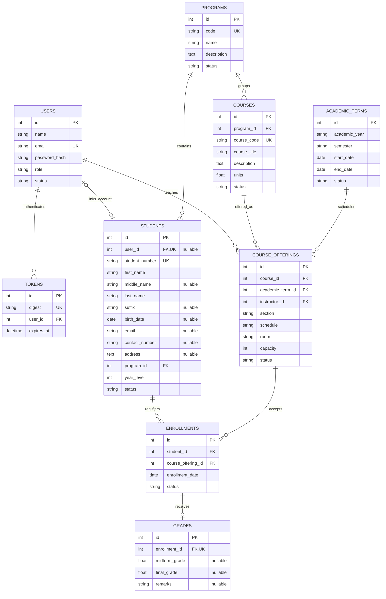

# Entity Relationship Diagram

Render this Mermaid diagram in a Markdown viewer with Mermaid support. All academic tables and users also have UTC `created_at` and `updated_at` timestamps.

Composite unique keys: `(academic_year, semester)` on terms, `(course_id, academic_term_id, section)` on offerings, and `(student_id, course_offering_id)` on enrollments.

An account linked to a student must have the STUDENT role; an offering's instructor must be an active INSTRUCTOR. Those cross-table role rules are enforced in the service layer. Most foreign keys use RESTRICT on deletion; tokens use CASCADE when an account is deleted. SQLite foreign-key enforcement is enabled on application connections.
